<a href="https://karagionikos.github.io/Portfolio/">
  <picture>
    <source media="(prefers-color-scheme: dark)" srcset="./assets/repo-galaxy-dark.svg">
    <source media="(prefers-color-scheme: light)" srcset="./assets/repo-galaxy-light.svg">
    
  </picture>
</a>

<!-- The card is regenerated every Monday by .github/workflows/repo-galaxy.yml.
     Edit the text and links in galaxy/config.json. -->

<!--### Tech

  

### Activity

  

-->
